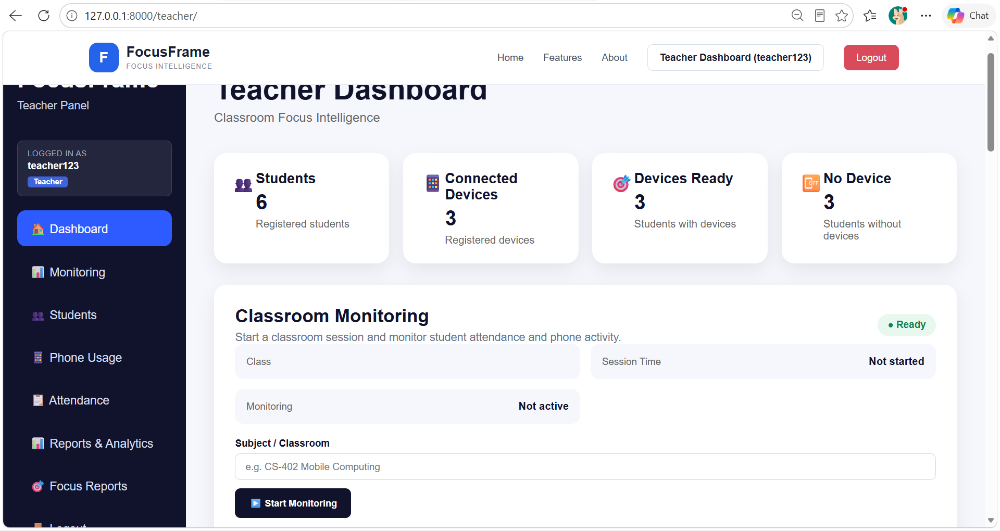
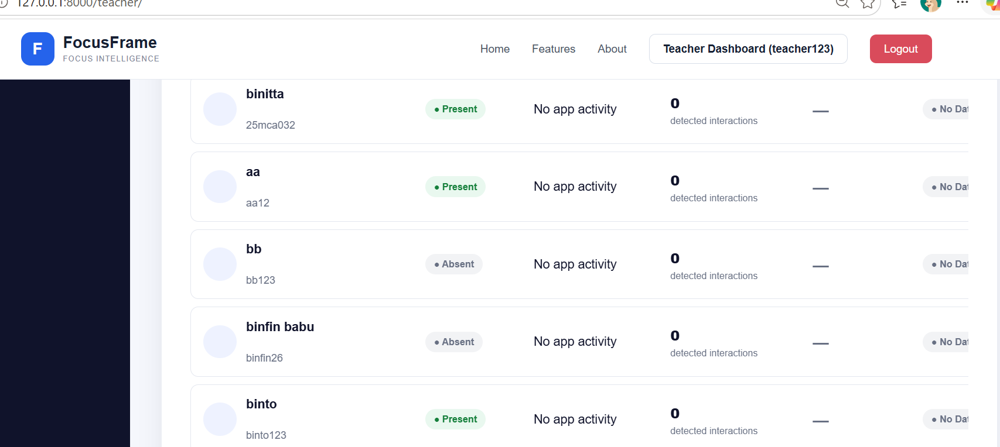
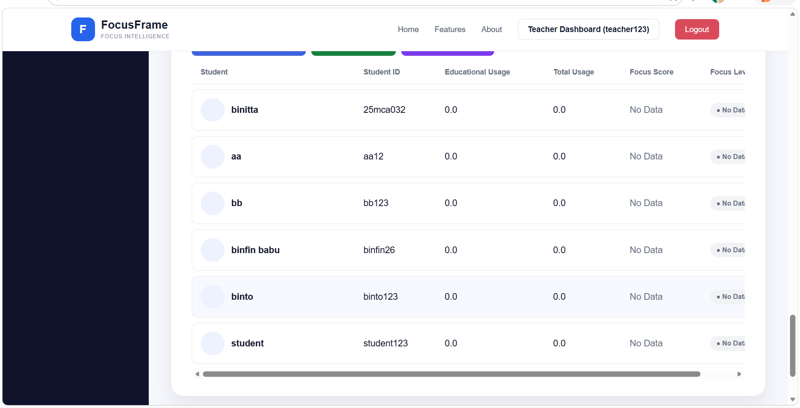
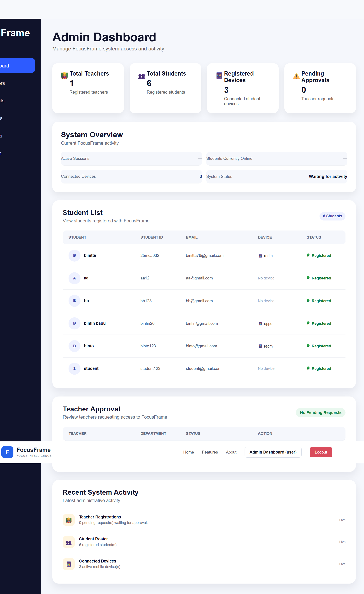

# FocusFrame – Classroom Attendance & Focus Intelligence

**FocusFrame** is a classroom attendance and mobile phone usage monitoring system designed to help teachers monitor student attendance, mobile phone activity, and classroom focus through a digital dashboard and Android monitoring application.

The system combines QR-based attendance, device monitoring, app usage categorization, focus scoring, and alerts.

## Project Overview

FocusFrame provides a centralized platform for classroom attendance management and mobile phone usage monitoring. It includes a web dashboard for teachers and administrators and an Android application for monitoring registered student devices.

## Key Features

- **QR-Based Attendance:** Students can mark attendance using QR codes linked to classroom sessions.
- **Android Device Monitoring:** Monitors application usage on registered student devices.
- **App Usage Categorization:** Classifies detected applications into educational, non-educational, and unknown categories.
- **Focus Score:** Calculates a classroom focus score based on phone usage activity.
- **Alerts:** Generates alerts based on detected phone usage activity.
- **Teacher Dashboard:** Provides student attendance and phone usage information.
- **Admin Dashboard:** Supports administrative monitoring and management.
- **Firebase Integration:** Synchronizes monitoring and attendance-related data.
- **Android Application:** Companion app developed using Kotlin and Jetpack Compose.

## Technology Stack

| Component | Technologies |
|---|---|
| Backend | Python, Django |
| Frontend | HTML, CSS, JavaScript |
| Mobile Application | Kotlin, Jetpack Compose |
| Database / Data Sync | Firebase Realtime Database, SQLite |
| Machine Learning | Scikit-learn |
| Model | Random Forest prototype |
| Tools | Git, GitHub, Android Studio |

## System Components

### Web Application
The Django web application provides authentication, teacher and administrator dashboards, classroom session management, attendance views, phone usage monitoring, and alert handling.

### Android Monitoring Application
The Android application monitors app usage on registered devices and sends usage information to Firebase during an active monitoring session.

### Classification and Focus Analysis
App usage categorization currently uses rule-based package classification. A separate Random Forest prototype has also been developed for experimentation with focus classification.

## Project Structure

```text
FocusFrame/
├── FocusFrameMonitor/     # Android monitoring application
├── data/
│   ├── focus_training/   # Training data
│   └── data_inspect/     # Data inspection resources
├── home/                 # Django application
├── myproject/            # Django project configuration
├── evaluate_focus_model.py
├── train_focus_model.py
├── focus_model_demo.joblib
├── manage.py
└── requirements.txt
```

## Project Status

- Django web application and dashboard components implemented.
- QR-based classroom attendance functionality implemented.
- Android usage monitoring application developed.
- Firebase data integration implemented.
- Rule-based application categorization implemented.
- Machine learning model prototype developed separately.

## Future Improvements

- Collect and validate real-world labeled data.
- Improve machine learning classification performance.
- Enhance dashboard analytics and visualizations.
- Expand automation and notification capabilities.
- Improve deployment and integration for production environments.

## Repository

GitHub: https://github.com/binittababu20-cmd/focusframe

---

*Developed as an academic project.*
## Project Screenshots

### Teacher Dashboard


### Student Dashboard


### Attendance Management


### Focus Score


### Additional Interface


### QR Code / QR Attendance

